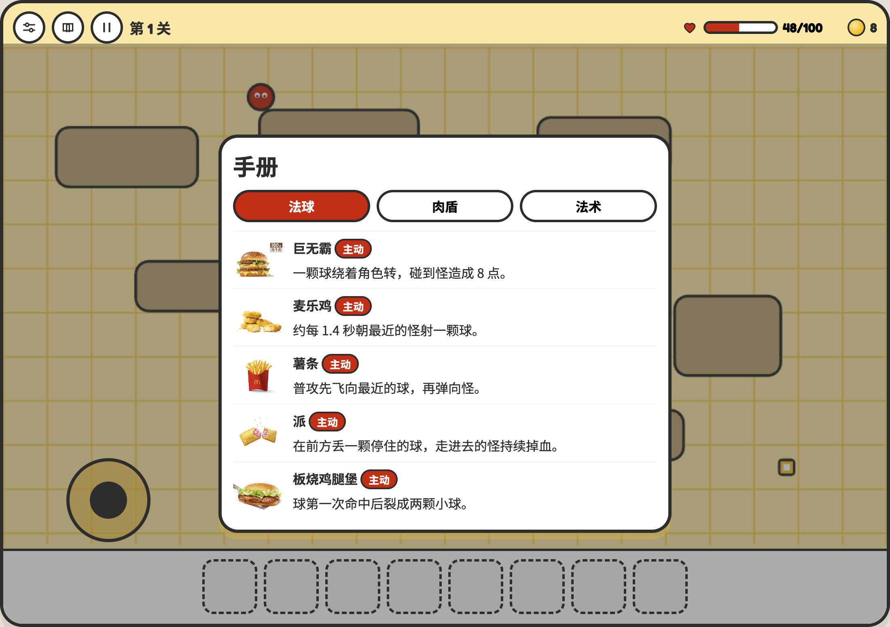

# 出餐奇遇

一款用麦当劳在售餐品做技能的俯视卡通网页游戏。玩家走动，普攻自动朝最近的怪物发射。餐品会变成法球、护盾或法术，价格就是局内的金币价格。

本项目由参赛者独立开发，不是麦当劳官方产品。不提供点餐、支付或营养建议。餐品名称、价格和图片来自麦当劳 MCP 的一次菜单快照，实时供应和价格以麦当劳官方渠道为准。

## 画面

横屏时技能格排成一行，竖屏时分成两行，轮盘都在左下角。手册按法球、肉盾、法术查看已经接上的餐品。




## 目标用户

想在浏览器里玩一局、并把真实菜单商品认成技能的玩家。电脑和手机都能打开。窗口偏宽时是横屏，偏高时是竖屏。

## 安装

需要 Node.js 20 或更新版本。

```bash
git clone https://github.com/rianlu/mcd-rogue.git
cd mcd-rogue
npm install
npm run dev
```

浏览器打开终端里显示的本地地址。

## 使用示例

- 电脑用 WASD 或方向键移动，也可以拖左下角轮盘。手机用轮盘。
- 普攻自动发射。点底部技能格可以查看效果，并按回收价卖出。
- 第 5 关和第 10 关清完后进入商店。商品现价就是金币价格，金币够就可以买多件。
- 左上角可以打开设置、手册和暂停。暂停也可以按 P 或 Esc。

打包静态页面：

```bash
npm run build
npm run preview
```

构建结果在 `dist/`。把该目录上传到静态托管即可，不需要在自己的电脑上常驻后端。

## 更新菜单快照

页面默认使用仓库里的快照，打开游戏的人不需要 Token。若要自行重新拉取：

1. 复制 `.env.example` 为 `.env`。
2. 在 `.env` 中把 `MCD_MCP_TOKEN` 设为本人的 MCP Token。不要把 `.env` 提交到仓库。
3. 运行 `node scripts/fetch-menu.mjs`。

配置示例见 `mcp-config.example.json`，其中只有环境变量占位符。调用说明见 [MCP_INTEGRATION.md](./MCP_INTEGRATION.md)。

## 已接入的技能

这一局可以获得并使用：巨无霸、麦乐鸡、薯条、派、板烧鸡腿堡、雪碧、圆筒冰淇淋、纯牛奶(盒装)、浓缩咖啡、100% 苹果汁(盒装)、锡兰红茶、麦辣鸡腿汉堡、苹果片。它们分别对应环绕法球、自动法球、跟随、驻留、分裂、汽水柱、冰环、护盾、反伤、残血回血、铁壁、加快法球生成和加快战场掉落。
