# 麦乐闯关

一款麦当劳主题的肉鸽网页游戏。俯视画面里走动、打怪、捡东西，餐品当作技能，菜单上的现价当作金币价格。

本项目由参赛者独立开发，不是麦当劳官方产品。不提供点餐、支付或营养建议。餐品名称、价格和图片来自麦当劳 MCP 的一次菜单快照，实时供应和价格以麦当劳官方渠道为准。

在线试玩：https://rianlu.github.io/mcd-rogue/

## 画面

电脑上整张地图都在画面里。手机竖着玩时镜头跟着人物走，右上角有小地图，轮盘跟着手指出现在左下角。打开后先看到封面，再选套餐。技能和神器在暂停或商店里查看，不占战斗画面。

### 开场

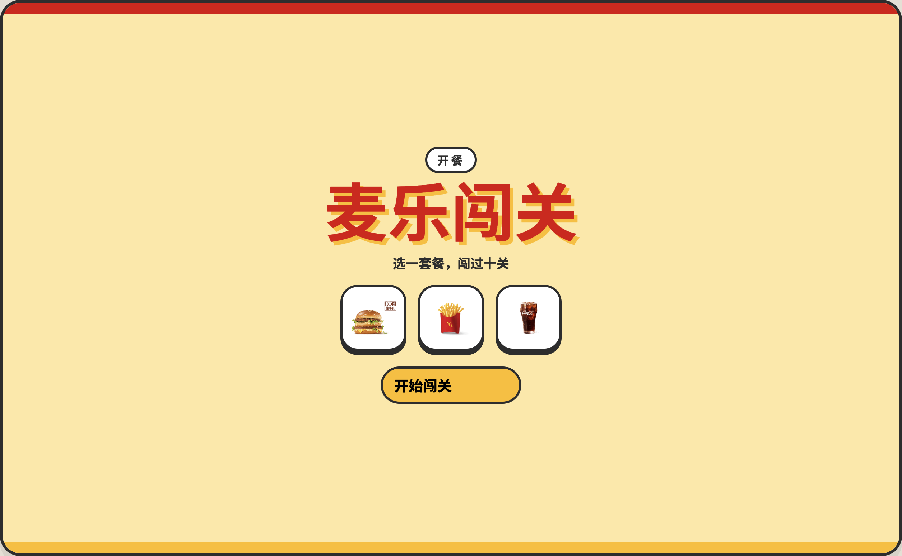

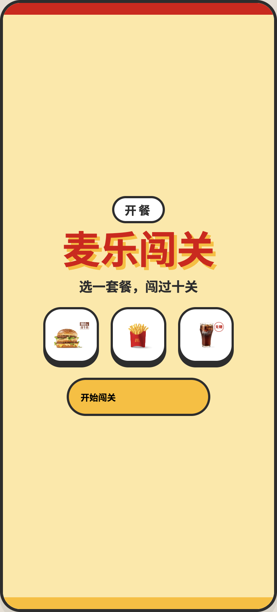

### 选套餐

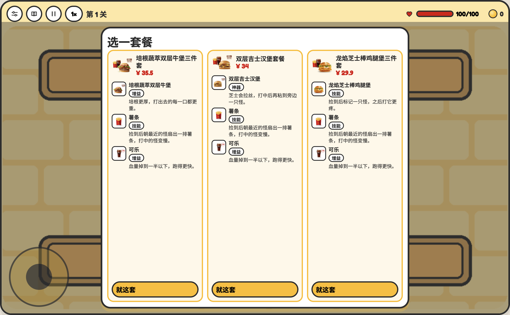

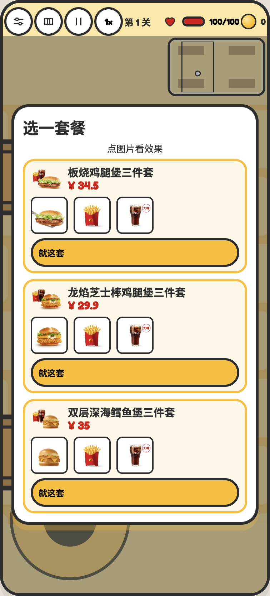

### 战斗

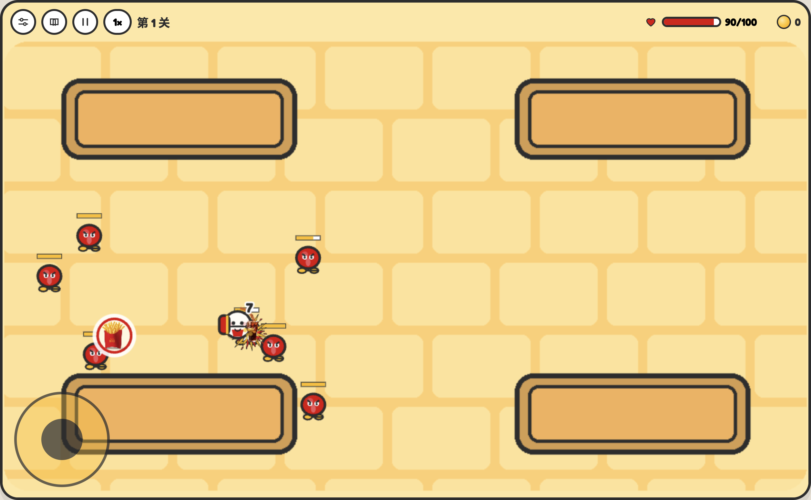

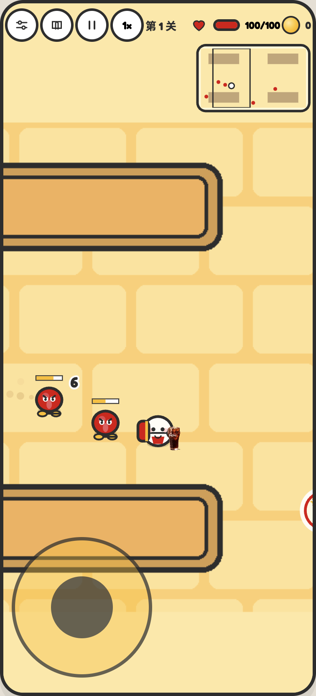

### 暂停

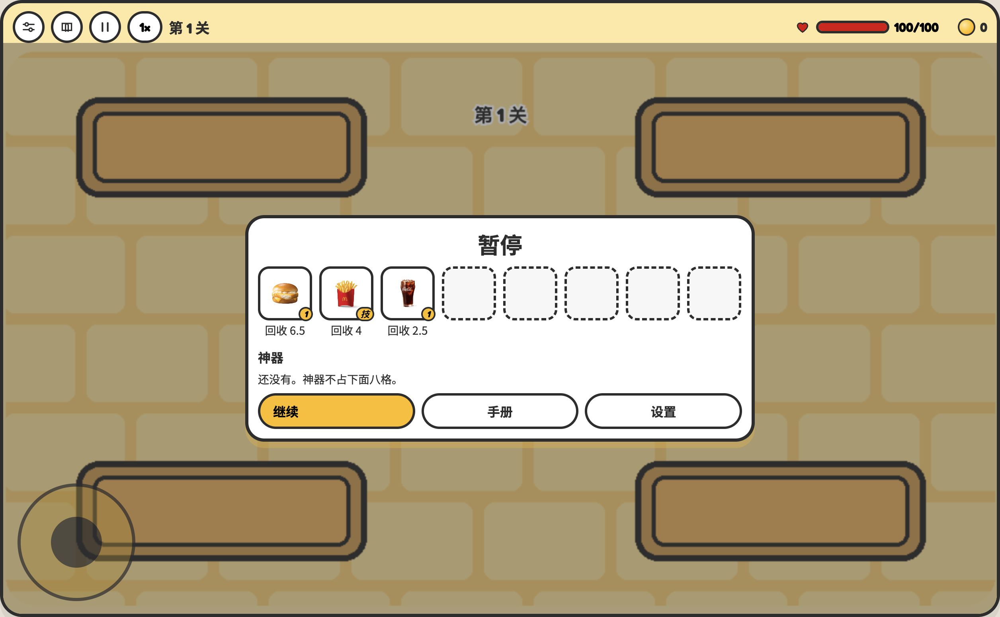

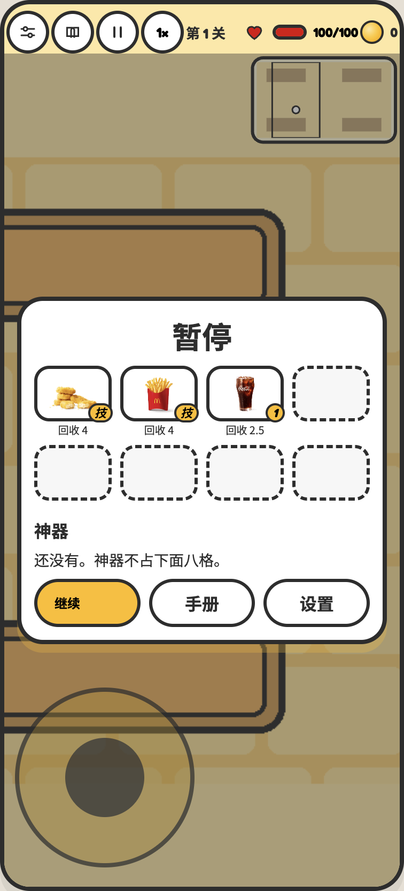

### 商店

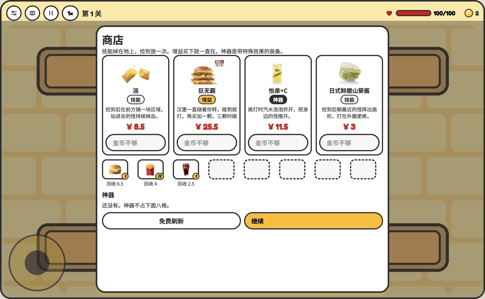

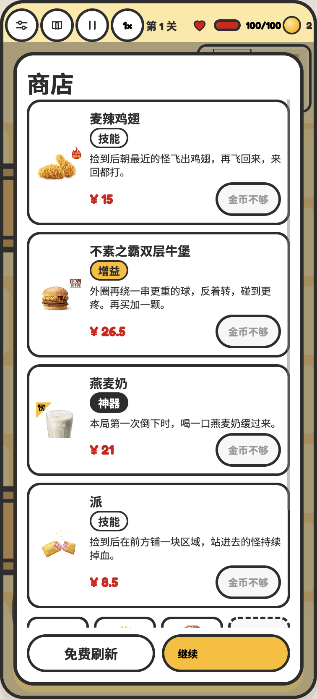

### 手册

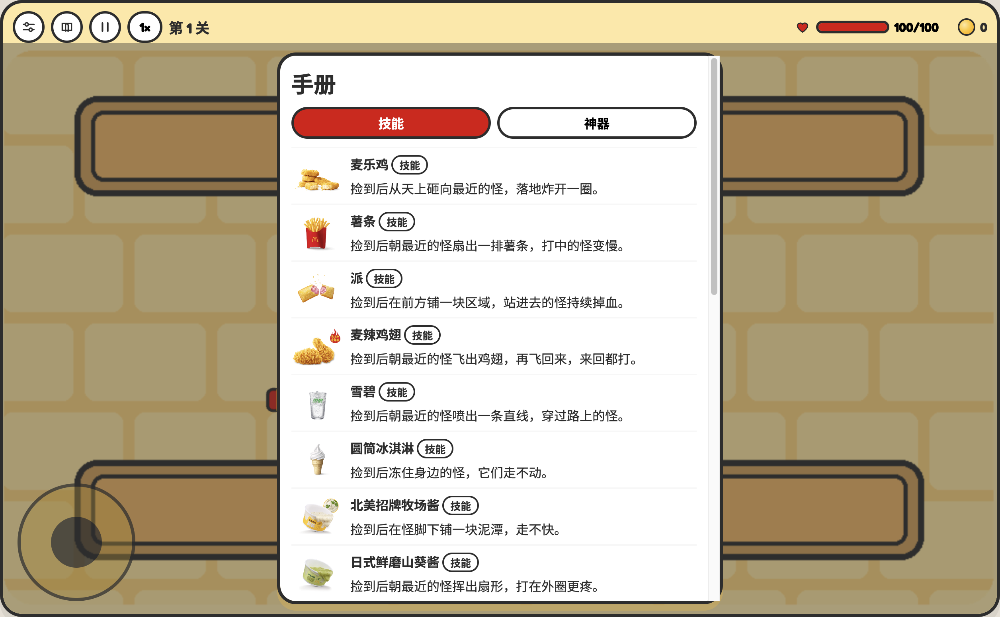

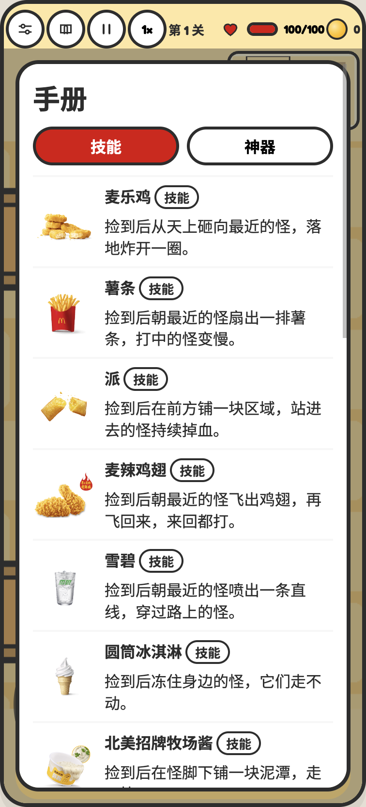

### 设置

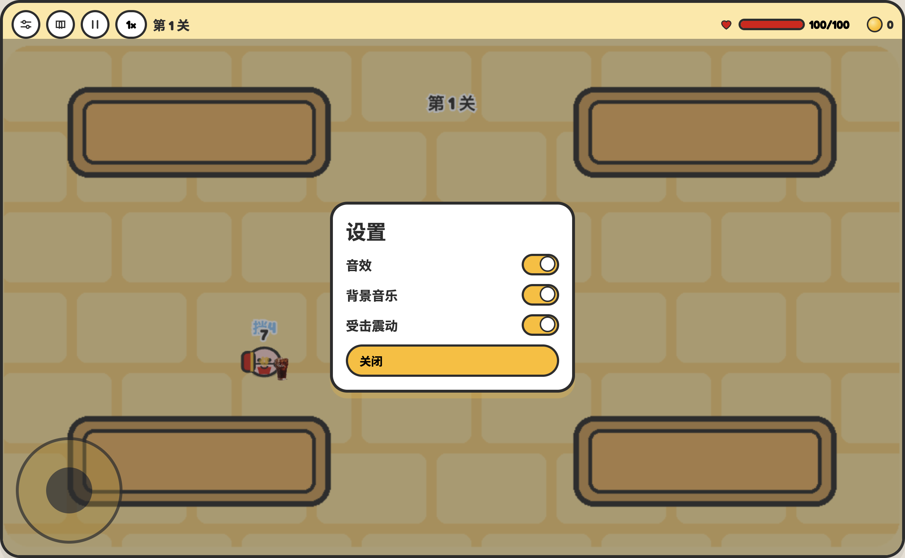

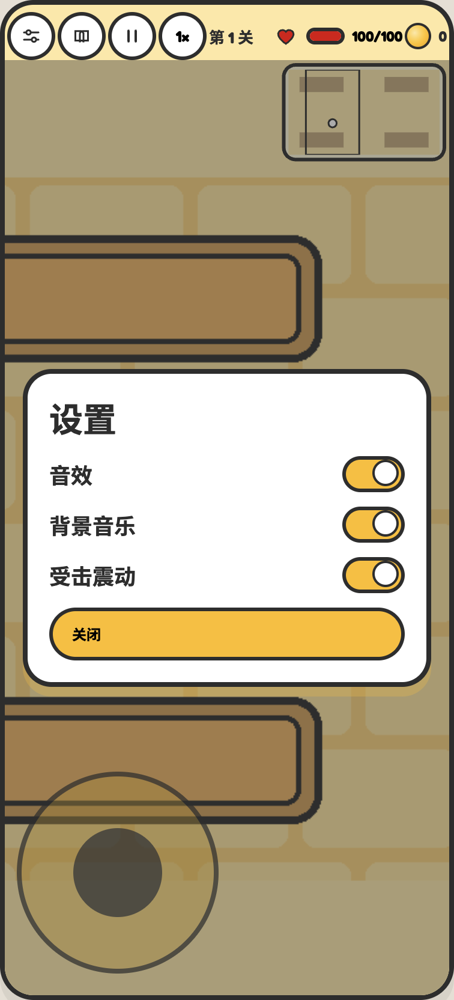

### 倒下了

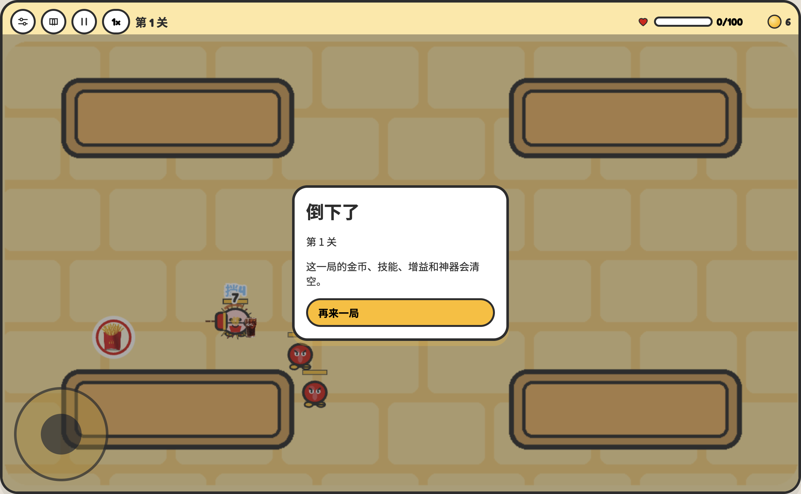

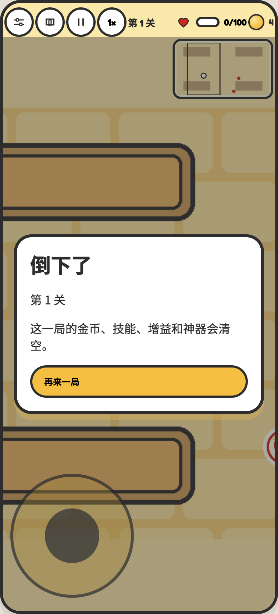

## 目标用户

想玩麦当劳主题肉鸽的人。电脑和手机都能玩，窗口偏宽是横屏，偏高是竖屏。

## 安装

需要 Node.js 20 或更新版本。

```bash
git clone https://github.com/rianlu/mcd-rogue.git
cd mcd-rogue
npm install
npm run dev
```

浏览器打开终端里显示的本地地址。

## 使用示例

- 打开后先点「开始闯关」，再从三套里选一套。套餐按菜单标价展示，不扣金币，带走里面的餐品。
- 电脑用 WASD 或方向键移动，也可以按住画面拖出轮盘。手机竖屏，手指按在画面上移动，镜头跟着人，右上角小地图看全场。
- 普攻自动朝最近的怪发射。买下的技能会掉在地上，捡到才放一次。暂停里能看到身上的技能和神器，回收前会再确认一次。
- 每一关清完，地上的东西先收走，再进商店。无尽里每一波也一样，而且一波比一波难。商店每次随机 4 件，第一次刷新免费，之后是 8、12、18 金币。增益买下后一直生效，神器不占八个格子。新地让靠近的怪变慢，经典麦旋风会把金币、血包、护盾和技能卷过来。
- 左上角可以打开设置、手册和暂停。暂停也可以按 P 或 Esc。第 5 关有冲锋头目，第 10 关是最终头目，之后进入无尽。

打包静态页面：

```bash
npm run build
npm run preview
```

构建结果在 `dist/`。把该目录上传到静态托管即可，不需要在自己的电脑上常驻后端。

## 更新菜单快照

页面默认使用仓库里的快照，打开游戏的人不需要 Token。若要自行重新拉取：

1. 复制 `.env.example` 为 `.env`。
2. 在 `.env` 中把 `MCD_MCP_TOKEN` 设为本人的 MCP Token。不要把 `.env` 提交到仓库。
3. 运行 `node scripts/fetch-menu.mjs`。

配置示例见 `mcp-config.example.json`，其中只有环境变量占位符。调用说明见 [MCP_INTEGRATION.md](./MCP_INTEGRATION.md)。

## 已接入的技能

商店从菜单快照里上了这些商品。技能买下后解锁，战斗里掉出来，捡到放一次，再买一次选强化。增益买下后一直生效，绕身的球也算增益。神器不占八个格子，买下后一直生效。名字、价格和图片都对得上快照。开局从 12 套三件套里随机抽 3 套。第 5 关有一只冲锋头目，第 10 关是最终头目，之后进入无尽。
